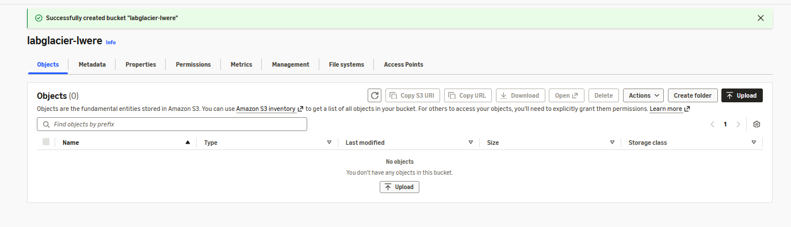
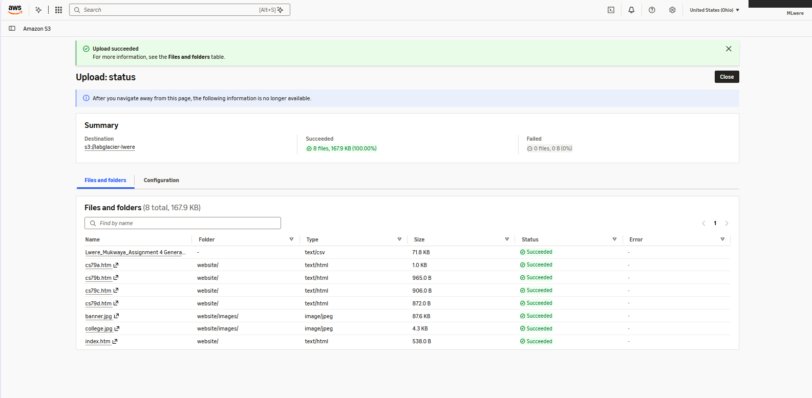
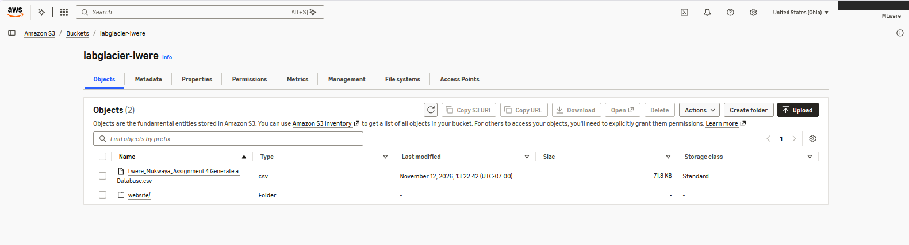
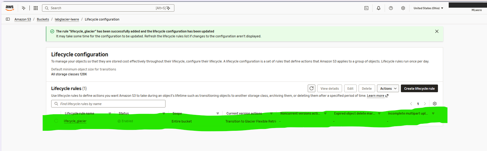
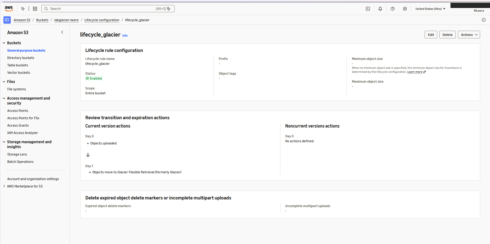
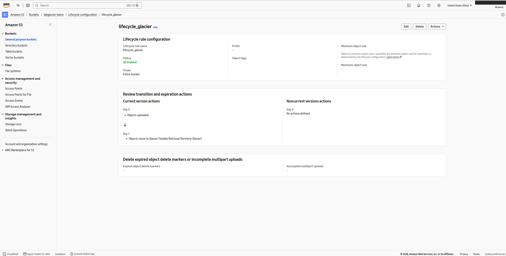

# Lab Report: S3 → Glacier Lifecycle Policy

**Name:** Mukwaya Lwere
**Class:** CS 79B
**Assignment:** Assignment 3 — S3 → Glacier
**Date:** 10/11/2026
**Region:** US East (Ohio) — `us-east-2`

---

## Objective
Create an Amazon S3 bucket, upload sample files, and configure an S3 Lifecycle policy that transitions objects to **Glacier Flexible Retrieval**. Then capture the required evidence: a policy summary and a view showing the converted storage class.

---

## Step 1: Create the S3 Bucket
A general purpose bucket named **`labglacier-lwere`** was created in `us-east-2`. The console confirmed *Successfully created bucket "labglacier-lwere"*, and the new bucket showed **Objects (0)**.



---

## Step 2: Upload Sample Files to the Bucket
Eight files (167.9 KB total) were uploaded to `s3://labglacier-lwere`, with **8 succeeded / 0 failed (100%)**:

| Name | Folder | Type | Size |
| :--- | :--- | :--- | ---: |
| `Lwere_Mukwaya_Assignment 4 Generate a Database.csv` | — | text/csv | 71.8 KB |
| `cs79a.htm` | `website/` | text/html | 1.0 KB |
| `cs79b.htm` | `website/` | text/html | 965 B |
| `cs79c.htm` | `website/` | text/html | 906 B |
| `cs79d.htm` | `website/` | text/html | 872 B |
| `banner.jpg` | `website/images/` | image/jpeg | 87.6 KB |
| `college.jpg` | `website/images/` | image/jpeg | 4.3 KB |
| `index.htm` | `website/` | text/html | 538 B |



The bucket's object list then showed the CSV and the `website/` folder, with the CSV in the **Standard** storage class (last modified November 12, 2026).



---

## Step 3: Create the S3 Lifecycle Policy
In *Management → Lifecycle rules*, a rule named **`lifecycle_glacier`** was created. The console confirmed: *The rule "lifecycle_glacier" has been successfully added and the lifecycle configuration has been updated.*



---

## Required Screenshots

### Policy Summary
| Setting | Value |
| :--- | :--- |
| Lifecycle rule name | `lifecycle_glacier` |
| Status | Enabled |
| Scope | Entire bucket (no prefix, no object tags) |
| Current version actions | Day 0: objects uploaded → **Day 1: move to Glacier Flexible Retrieval (formerly Glacier)** |
| Noncurrent version actions | None defined |
| Expired delete markers / incomplete multipart uploads | None defined |



The same rule expressed as JSON is in [`policy/lifecycle_glacier.json`](../policy/lifecycle_glacier.json).

### Executed Policy (Storage Class Converted)


> **Verification note:** to show the converted storage class directly, open the bucket's object list after the rule has run (24–48 hours) and look at the **Storage class** column, or run `bash scripts/verify_storage_class.sh`. Objects that moved show `GLACIER`.

---

## Troubleshooting: Objects Still Show "Standard"

Lifecycle rules are evaluated **once per day**, so a Day 1 transition can take 24–48 hours to appear. If objects still show **Standard** after that, check the minimum object size.

The console showed *"Default minimum object size for transitions: All storage classes 128K"*. By default, S3 does not transition objects smaller than 128 KB to Glacier storage classes. Every object uploaded in this lab is smaller than 128 KB (the largest is 87.6 KB), so they may stay in Standard.

**Fix (lab only):** edit the rule and set a minimum object size so small objects are included, or apply [`policy/lifecycle_glacier_small_objects.json`](../policy/lifecycle_glacier_small_objects.json):

```bash
aws s3api put-bucket-lifecycle-configuration \
  --bucket labglacier-lwere \
  --lifecycle-configuration file://policy/lifecycle_glacier_small_objects.json
```

**Production note:** archiving tiny objects is rarely cost-effective, because Glacier adds per-object metadata overhead and a 90-day minimum storage charge. Archive larger or bundled objects instead.

---

## Key Takeaways
* S3 Lifecycle rules automate cost optimization by moving data between storage classes on a schedule, with no application changes.
* Glacier Flexible Retrieval is intended for archival data that is rarely accessed; retrievals take minutes to hours.
* Lifecycle evaluation is asynchronous (daily), and the minimum object size setting can prevent small objects from transitioning.
* Lifecycle policy as code (JSON/CLI) makes the configuration repeatable and reviewable.

## Clean-Up
```bash
aws s3 rm s3://labglacier-lwere --recursive
aws s3api delete-bucket --bucket labglacier-lwere --region us-east-2
```
